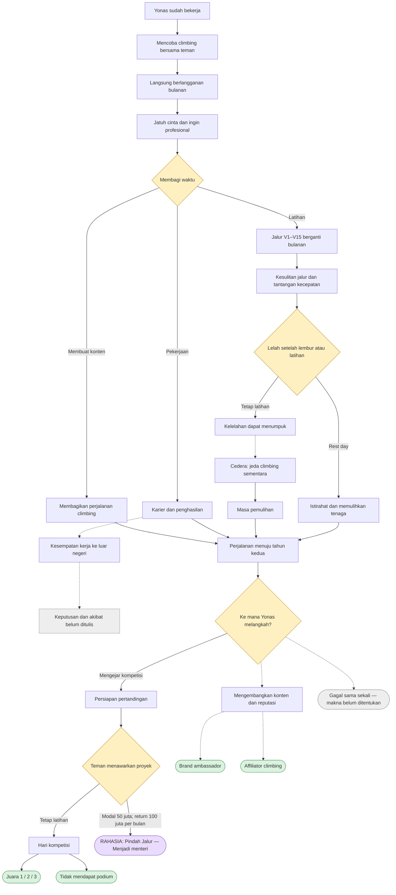

# Peta cerita awal

Ini rangkuman visual untuk melanjutkan penulisan, bukan seluruh percabangan final. Garis putus-putus menunjukkan hubungan atau akibat yang masih perlu digarap. Jalur cedera tidak berarti setiap pemain wajib mengalaminya; penempatannya belum dikunci.

## Catatan FigJam

Pengguna meminta papan visual di FigJam melalui Figma. Pemanggilan pembuatan diagram sebelumnya meminta pemilihan tim/organisasi dan belum menghasilkan tautan papan yang terkonfirmasi. Tidak ada URL FigJam yang sudah disimpan. Diagram Mermaid ini menyimpan isi peta agar tidak bergantung pada langkah tersebut.
