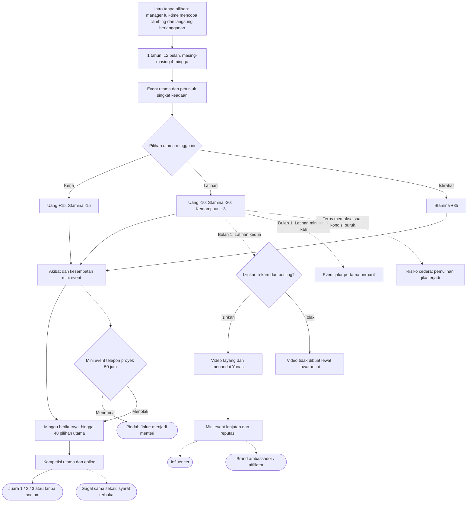

# Peta cerita

Peta merangkum kesepakatan, bukan semua percabangan final. Garis putus-putus menunjukkan peluang bersyarat atau detail yang belum dirinci.

[FigJam — Perjalanan Yonas](https://www.figma.com/board/gVs4wVijce1YfwekofJmMI/Perjalanan-Yonas)

Bagian papan: [panduan rutin](https://www.figma.com/board/gVs4wVijce1YfwekofJmMI?node-id=9-148), [12 event utama](https://www.figma.com/board/gVs4wVijce1YfwekofJmMI?node-id=12-148), [bulan pertama](https://www.figma.com/board/gVs4wVijce1YfwekofJmMI?node-id=12-188), [influencer](https://www.figma.com/board/gVs4wVijce1YfwekofJmMI?node-id=12-208).

Catatan sinkronisasi: Git ini memuat keputusan setelah edit FigJam terakhir. Papan masih perlu diselaraskan untuk istilah Stamina, angka indikator, Kemampuan tanpa batas, syarat Latihan 2/3 kali bulan pertama, izin rekam sekaligus posting, serta detail bulan 2 dan 3 di dokumen Git. Waktu kemunculan mini event masih belum diputuskan: pilihan pertama atau setelah jumlah minimal kegiatan; syarat bulan 1 tetap berlaku sementara.

Semua indikator tersembunyi. Uang, Stamina, Reputasi 0–100; Kemampuan mulai 0 tanpa batas maksimal. Angka kegiatan adalah nilai dasar awal yang perlu dicoba, bukan jaminan hasil pertandingan.
